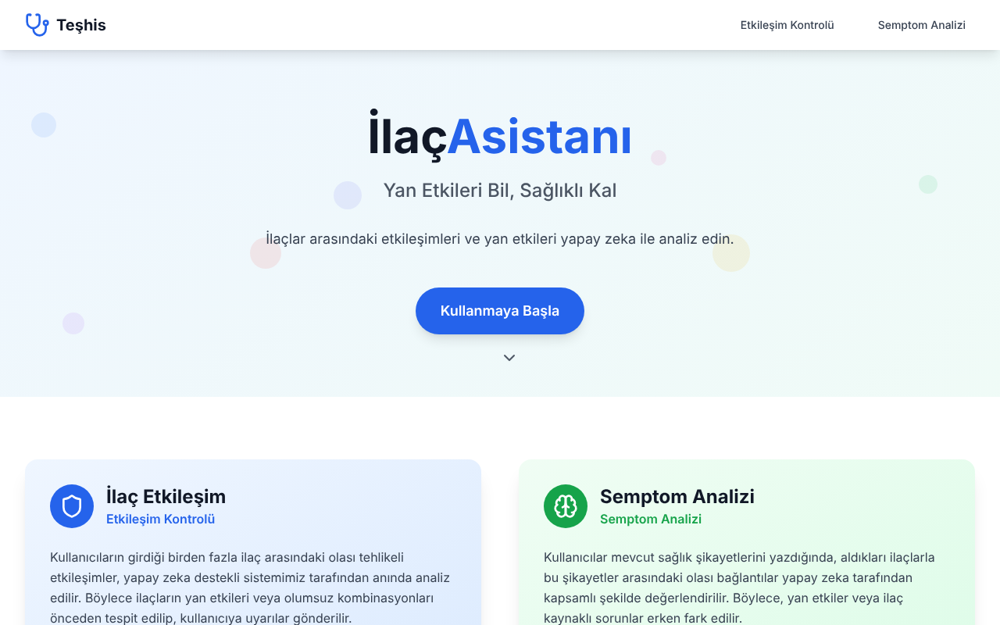
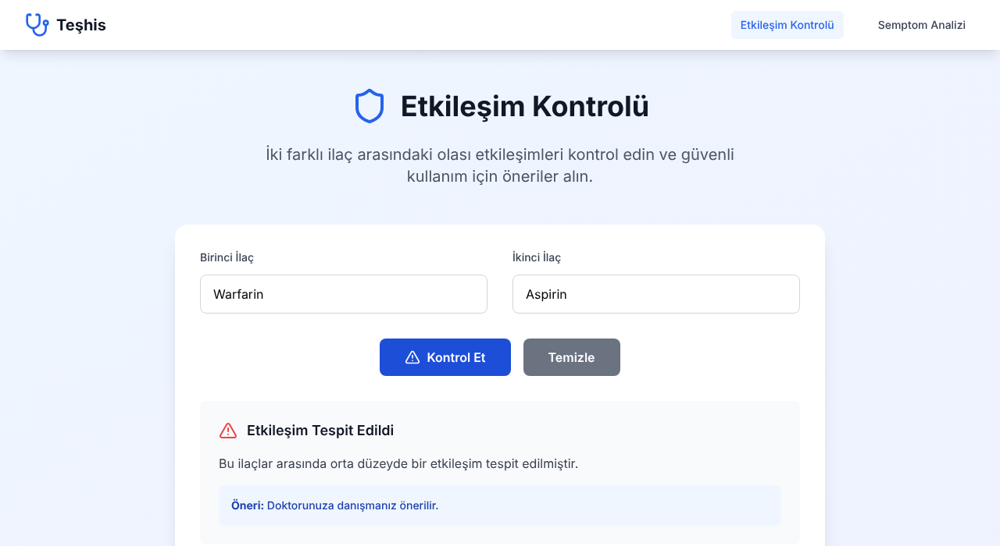
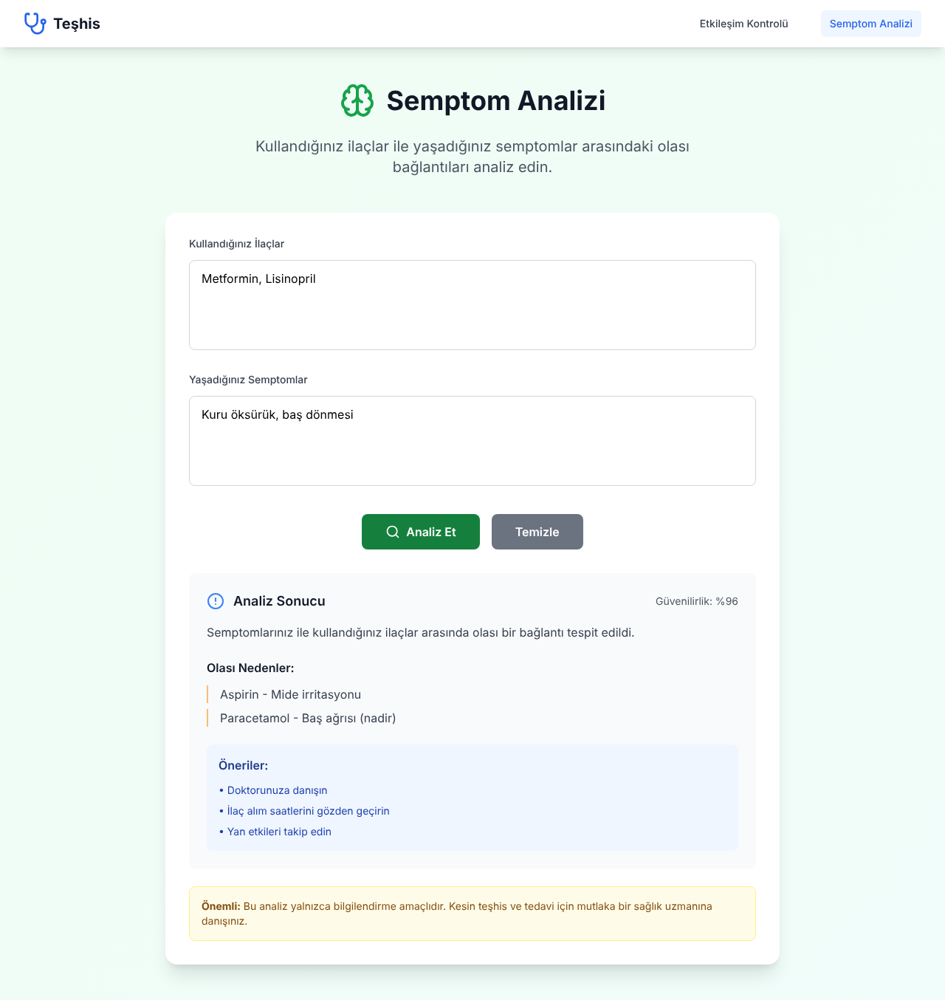

# İlaçAsistanı — Drug Interaction & Symptom Analysis (Prototype)

A web prototype that lets users check whether two medications interact and whether their symptoms could be side effects of the medications they take. The goal was to support these checks with an AI model (Google Gemini). This repository contains the **front-end prototype** built during Sprint 1.

Developed by a five-person team in the **Google Game and App Academy (YZTA) Bootcamp**, 2025.


> ⚠️ **Prototype:** The AI integration was not completed. Interaction and symptom results are **randomly generated mock data**, not real medical analysis. Do not use this app for health decisions. The interface is in Turkish.



| Interaction check | Symptom analysis |
| --- | --- |
|  |  |

## Features

- **Home page:** introduction to the two tools, with call-to-action buttons.
- **Drug interaction check** (`/etkilesim-kontrolu`): enter two medications and get an interaction result with a short explanation and a recommendation.
- **Symptom analysis** (`/semptom-analizi`): enter your medications and symptoms and get a possible relationship, confidence score, likely causes and recommendations.
- **Responsive layout:** navigation bar with a mobile menu, built with Tailwind CSS and Lucide icons.
- **Health disclaimer** on symptom analysis results.

## Tech Stack

| Area | Technology |
| --- | --- |
| Framework | React 18, TypeScript |
| Build tool | Vite |
| Routing | React Router |
| Styling | Tailwind CSS, Lucide React icons |
| Linting | ESLint |

The UI was scaffolded with [Bolt.new](https://bolt.new) and then adapted by the team.

## Project Structure

```
src/
├── components/
│   └── Navbar.tsx            # Top navigation with mobile menu
├── pages/
│   ├── HomePage.tsx          # Landing page
│   ├── InteractionCheck.tsx  # Drug–drug interaction check
│   └── SymptomAnalysis.tsx   # Medication–symptom analysis
├── services/
│   └── README.md             # Planned API layer for the LLM integration
├── App.tsx                   # Routes
└── main.tsx                  # Entry point
docs/
├── SPRINT-1-REPORT.md        # Original sprint report (Turkish)
└── screenshots/
```

## Getting Started

```bash
git clone https://github.com/tunaxdev/ilac-asistani.git
cd ilac-asistani
npm install
npm run dev
```

Then open `http://localhost:5173`. Use `npm run build` for a production build.

## Planned Next Steps

The [`src/services`](src/services/README.md) folder describes the intended API layer: typed `checkDrugInteraction` and `analyzeSymptoms` functions calling a Gemini-based backend, replacing the current mock results.

## Team

| Name | Role |
| --- | --- |
| Zeynep Sena Koç | Scrum Master |
| Umut Tuna | Front-End Developer |
| Sadık Can Barut | Developer |
| Şevval Savrunlu | Developer |
| Fatıma Zeyneb Kotan | Developer |

The team worked in Scrum sprints with daily stand-ups and sprint reviews. See the [Sprint 1 report](docs/SPRINT-1-REPORT.md) for the backlog, retrospective and screenshots of the process.

The original team repository is [scbarut/YZTA-Bootcamp](https://github.com/scbarut/YZTA-Bootcamp).
